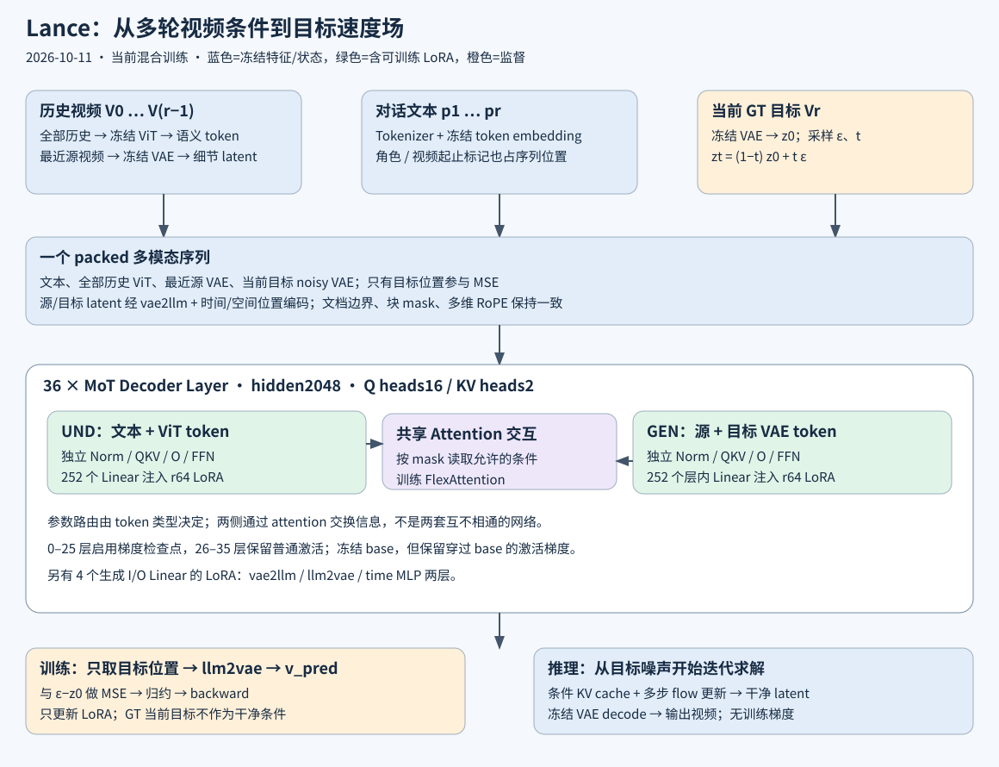
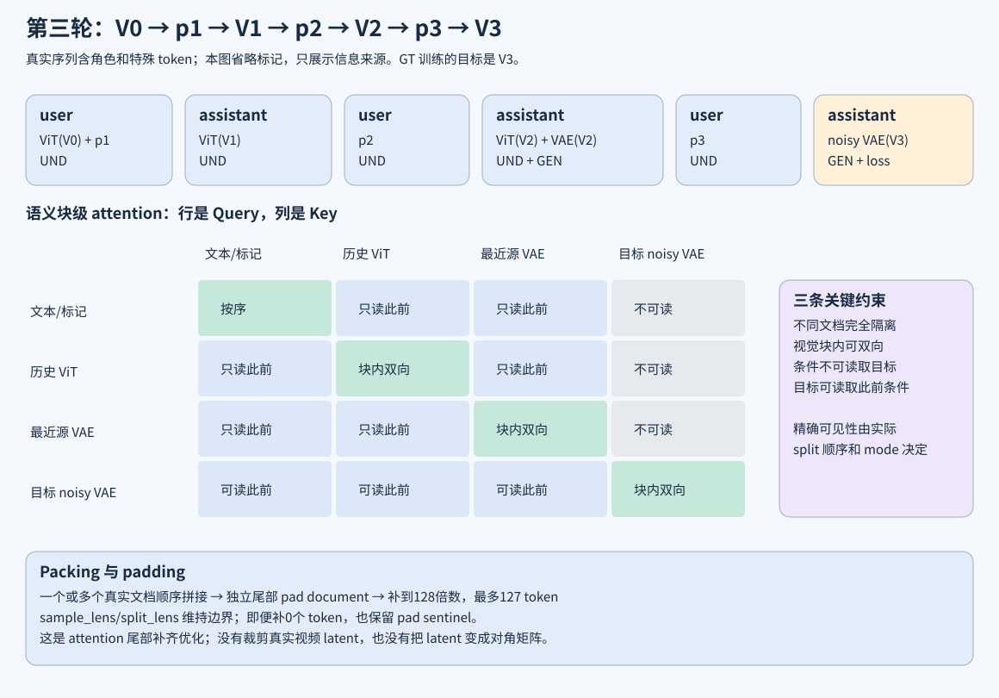
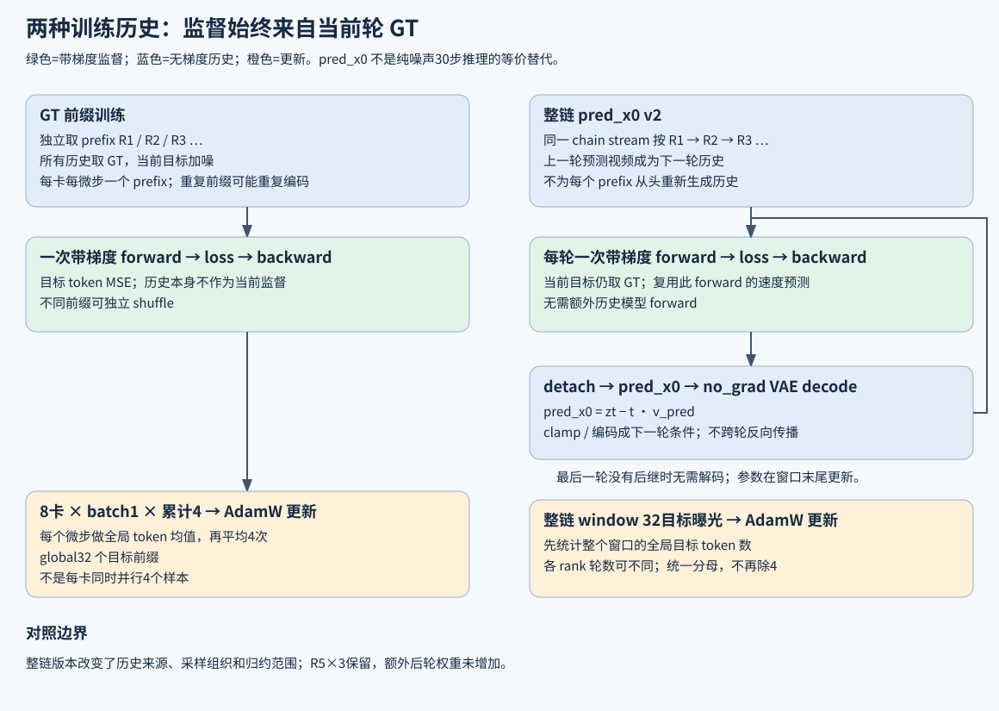

# 当前 Lance 训练架构详解

> **同日后续扩展说明**：正文与三张图记录既有 GT/pred_x0 训练架构；之后新增了[每轮可选单张 ViT 参考图](datamake_optional_reference_image_20261011.md)。参考图作为额外静态 ViT 条件进入对应 user 回合，不成为源/目标 VAE，不新增目标 loss。无图路径保持原行为，双分支主干、LoRA范围与部分梯度检查点方案不变。小尺寸真实 GPU 推理/训练验证通过，但现有正式训练数据没有参考图样本，旧 checkpoint 尚未学习该任务。分支编辑、参考图 VAE、多视角与动作参考均未实现；下文图中的历史视频不是新增的外观参考图片。

> 核验日期：2026-10-11，Asia/Singapore。描述对象是当前工作区实际使用的 UE＋CoinVE、八卡 DDP、双分支 LoRA 训练，以及整链 pred_x0 变体。依据为本地代码、有效 profile、运行快照与历史验证报告；不是仅按上游论文推断。Technical owner：[训练接入](../training_integration.md)。实时作业与 checkpoint 数字统一见[进度快照](datamake_progress_20261011.md)。

[浏览器阅读版（内嵌三张SVG）](datamake_current_architecture_20261011.html)。阅读顺序：先看第 1–3 节与三张图，再看第 4–10 节的实现，最后看第 11–15 节的推理、优化与修改边界。下文 `lance/` 指工作区内的上游 clone，已经叠加 DataMake patches；“上游函数”不等于“文件从未修改”。

## 1. 一句话理解整个系统

给定历史视频和编辑指令，冻结的 ViT 把历史视频转换为语义 token，冻结的 VAE 把最近参考视频转换为细节 latent；Lance 把这些条件、对话文本与当前目标的带噪 latent 放进同一个 Transformer，通过 flow matching 学习预测目标 latent 的速度场。训练只更新 Transformer 内部理解侧与生成侧的 LoRA，推理再把去噪后的 latent 经 VAE 解码为视频。



有四个容易混淆的概念：

| 名称 | 实际含义 | 当前是否训练 |
| --- | --- | --- |
| ViT 编码器 | 从视频像素提取视觉 token | 冻结、无梯度提特征 |
| VAE 编码器/解码器 | 像素与压缩 latent 之间转换 | 冻结、no_grad |
| 理解分支 UND | Transformer 中处理文本和 ViT token 的投影、归一化和 FFN | 只训练其指定 Linear 上的 LoRA |
| 生成分支 GEN | 同一 Transformer 中处理源/目标 VAE token 的另一套投影、归一化和 FFN | 只训练其指定 Linear 与生成 I/O 上的 LoRA |

因此，“同时训练双分支”不表示训练 ViT＋VAE 两个编码器，也不是两套独立视频生成模型。

## 2. 有效配置：不能只看模型目录名称

基座为本地 `models/Lance/Lance_3B_Video/`，配置取自 `llm_config.json`，再由训练入口覆写相关运行选项。`3B` 是发布目录名称，不能用它替代当前双分支模型实际参数枚举。

| 部件 | 当前值 | 解释 |
| --- | --- | --- |
| Transformer | 36 层、hidden 2048 | 每个 token 的主干表示为 2048 维 |
| Attention | 16 个 Q heads、2 个 KV heads、head dim 128 | GQA，多组 Q 共享 K/V |
| FFN | intermediate 11008、SiLU 门控 | 两套分支各自有 gate/up/down |
| 位置编码 | 多维 RoPE，sections `[16,24,24]`，theta=1,000,000 | 图像/视频网格与文本位置共同决定旋转位置 |
| Layer 类型 | `Qwen2MoTDecoderLayer` | token 类型决定走 UND 还是 GEN 参数 |
| QK normalization | UND/GEN 均开启 | Q/K 投影后还有归一化 |
| Embedding tying | 运行参数设为 false | 不可照抄基座 JSON 的 true 作为有效值 |
| ViT | depth32、hidden1280、heads16、out2048 | patch14、temporal patch2、空间 merge2 |
| ViT 注意力 | window112；full-attention blocks 7/15/23/31 | 与主干的混合多模态 mask 是两件事 |
| VAE | Wan 2.2、latent channels48 | 时间压缩4、空间压缩16 |
| latent patch | `[1,1,1]` | 每个 VAE 网格点的 48 维向量成为一个 latent token |

主干配置声明的最大位置范围不等于当前训练预算。Dataset 的 token 上限、视频 resize、链长度、padding 和 GPU 显存共同决定实际可训练输入。

来源：[基座配置](../models/Lance/Lance_3B_Video/llm_config.json)、[建模与参数设置](../lance/train/train_utils.py)、[MoT 层](../lance/modeling/lance/qwen2_navit.py)、[VAE 实现](../lance/modeling/vae/wan/model.py)。

## 3. 一个真实样本从磁盘到 loss 的完整路径

以三轮编辑链为例：`V0 --p1--> V1 --p2--> V2 --p3--> V3`。`V` 为视频，`p` 为编辑文本。训练第三轮时，模型的条件是 V0、V1、V2 和 p1、p2、p3；监督目标是 V3。



大致调用路径如下，实际函数定位见第 14 节：

```text
jobs/datamake_coinve_mixed_ddp8_lora64_both_no_region_v1.sbatch
  -> scripts/run_datamake_ddp_training.py
     -> 读取 profile + source_profile，生成有效参数，检查启动/恢复合同
     -> torchrun（8 个 rank）
        -> lance/train/datamake_ddp_train.py
           -> IndexedPrefixDataset / 混合 Dataset
           -> 读取 parquet 中的原视频引用，成对裁剪、resize、采样
           -> 按角色创建对话、ViT/VAE 索引、sample/split 元数据
           -> 冻结 ViT / VAE 提特征，缩减 attention 尾部 padding
           -> Lance.forward：加噪、36 层 MoT、预测速度、逐 token MSE
           -> compute_training_loss：归约 + DDP/累计缩放
           -> backward -> clip -> AdamW -> scheduler
           -> 定期保存完整 checkpoint
```

一个 prefix 的正常监督微步只有一次带梯度模型 forward，随后一次 backward。开启梯度检查点时，backward 内会重算被包裹层的局部 forward；这不等于额外取了一条训练数据。冻结编码器的 forward、历史视频解码也不应混计为带梯度监督 forward。

## 4. 数据如何组织：视频不需要重新复制

### 4.1 原始媒体、链和前缀是三个层级

合成数据的节点视频由确定性配置图生成，多个编辑边/链可以引用同一个节点；链记录视频路径序列和指令序列。训练索引引用这些路径，不把同一原视频为每条链复制一遍。

GT 训练把一条 R 轮链展开为 R 个目标前缀。例如上面的三轮链分别产生：

| 前缀 | 历史条件 | 本次唯一监督目标 |
| --- | --- | --- |
| R1 | V0、p1 | V1 |
| R2 | V0、p1、V1、p2 | V2 |
| R3 | V0、p1、V1、p2、V2、p3 | V3 |

同一前缀中的早期视频是条件，不再次作为本次 loss 的目标。多条 prefix 会重复读取或编码相同历史，这是 GT 前缀方案与整链方案的效率差别之一。

混合索引位于 `outputs/training_data/datamake_coinve4k_mixed_r5x3_seed20260911_v1/`。UE 保留原链级 split；CoinVE 以 source/target/prompt 的单轮链加入。数据字段包含 sample/chain 身份、target_round、prompts、video_paths、dataset_origin，以及 CoinVE 的共同时间窗与重复采样身份。

冻结统计：混合 train/validation/test 为 7201/395/404 条链；训练原始前缀 17084，R5×3 后 18276；validation/test 为 949/967 条前缀。R5×3 只提高合成第五轮的曝光次数，CoinVE 不重复三次。完整构建和核验口径见[混合数据报告](datamake_coinve_mixed_dataset_20260911.md)。

“一个 epoch”应按对应 sampler 的完整遍历理解。GT 遍历加权前缀；整链遍历 chain stream 和目标曝光，两者的游标与每次 optimizer window 的组成不同，不能仅用链数/32 换算出相同 epoch。

### 4.2 CoinVE 采用相同绝对时间窗

source 与 target 共享 `[start, start+5 秒]`，各自按 FPS 转换起止帧，再在共同窗口内采样。**不是分别把两个完整视频缩放为相同帧数。**因此，总时长 13 秒与 8 秒不同，不自动造成全局时间缩放错配。

当前 5 秒、12 FPS、`4k+1` 约束下，VAE 分支取 61 帧；ViT 为 temporal patch2 复制末帧，得到 62 帧。这是 CoinVE 配置口径，不能把所有合成视频也一概写成 61 帧。

共同时间窗不能修复原视频内容本身的延迟、转场错位、停帧和动作速度改变。用户此前允许暂缓内容时序专项清洗、复合编辑拆分与同源视频重划分；这些仍是数据质量边界，不能在文档中写成已消除。

### 4.3 空间预处理与归一化

VAE 的 resolution 配置为 480，ViT 为 448，配合长宽比 bucket 使用；不是把每条视频直接变成 480×480 / 448×448。VAE 尺寸按16对齐，ViT 按28对齐。VAE 像素用 mean/std=.5/.5 转成约 `[-1,1]`；ViT 使用其专用 RGB mean/std。两条分支不能共享错误的归一化。

VAE 的像素 tensor 为 `[3,T,H,W]`，编码后为 `[t,h,w,48]`；61 帧、352×624 的示例变成 `[16,22,39,48]`，即 **13728 个 latent token**。源 VAE 与目标 VAE 各一份就已是 27456 token，再加历史 ViT 和文本。这解释了 batch1 仍可能很贵。

这个尺寸示例对应当前真实数据路径可产生的 bucket，不是全部样本的固定形状。VAE 使用 posterior 的采样逻辑时 RNG 也影响编码，所以固定 seed、恢复 RNG、不要在对照中随意改变编码调用次序。

## 5. 输入序列：哪些历史以什么形式进入模型

训练第三轮的语义结构可写成：

```text
user:      ViT(V0) + p1
assistant: ViT(V1)
user:      p2
assistant: ViT(V2) + VAE(V2)
user:      p3
assistant: noisy_VAE(V3)        <- 只有这里产生 flow loss
```

真实序列还包含 role、视频起止标记、placeholder 等特殊 token；上面省略了标记，用于说明信息来源。第一轮时最近源视频就是 V0，其 VAE 放在对应 user 视频块。

核心规则：

1. 所有先前视频提供 ViT 特征，支持理解多轮视觉历史。
2. **只有最近的参考视频**额外提供 VAE latent，给当前编辑保留细节；不是所有历史都堆一份 VAE latent。
3. 当前 GT 目标不提供干净 ViT 条件，只提供被加噪后的目标 VAE token，并在相应位置计算 loss。
4. 前缀对话结束在当前目标；不能把未来轮次、未来 GT 或当前干净目标意外放进条件。
5. 当前“历史”包含之前的视频和之前的指令，不能退化理解为仅最近 source＋当前 prompt 的单轮编辑。

主要元数据如下：

| 字段 | 作用 |
| --- | --- |
| `packed_text_indexes` | 文本与特殊标记放进主干序列的位置 |
| `packed_vit_token_indexes` | ViT 特征覆盖的序列位置 |
| `packed_vae_token_indexes` | 源/目标 latent 的位置；决定 GEN 路由 |
| `mse_loss_indexes` | 当前目标的监督位置；不等于所有 VAE 位置 |
| `sample_lens` | packed 文档边界，包括尾部 pad sentinel |
| `split_lens`、attention mode | 文档内文本/视觉块边界及注意力规则 |
| latent/grid shape、position ids | 还原视频网格和多维位置，必须与 flatten 次序一致 |

来源：[角色感知 Dataset](../lance/data/datasets_factory/dataset_datamake_multiturn_v2v_local.py)、[混合 Dataset](../lance/data/datasets_factory/dataset_datamake_mixed_v2v_local.py)。

## 6. Transformer 内部：双分支与注意力

### 6.1 token 路由，不是学习 top-k 专家选择

每层根据 token 类型决定参数组：文本与 ViT token 用 UND，源 VAE 和目标带噪 VAE token 用 GEN。两组都有自己的 RMSNorm、Q/K/V/O 投影和 SwiGLU FFN。

简化的一层为：

```text
h -> 按 token 类型选 RMSNorm
  -> UND 或 GEN 的 Q/K/V 投影 -> QK norm + 多维 RoPE
  -> 放回同一序列，在 mask 允许范围内做 attention
  -> 按 token 类型选 O 投影 -> residual
  -> 按 token 类型选 RMSNorm + gate/up/down FFN -> residual
```

UND 与 GEN 的 token 可以通过同一次 attention 交换信息。这里不是两条永不交互的网络，也不需要另加一层传统 text-to-video cross-attention 才能读取文本条件。`moe_gen` 这个参数后缀不能据此理解成带学习路由器的稀疏 top-k MoE。

以 N 个 token 为例，Q 投影的逻辑形状为 `[N,16,128]`，K/V 为 `[N,2,128]`；每8个Q head共享一组K/V。注意力的数学形式仍是 `softmax(QKᵀ/√128 + mask)V`，只在允许位置参与归一化。内核可以分块计算，并不要求在显存中保存一整张 N×N 稠密矩阵。FFN 是 `down(SiLU(gate(h)) * up(h))`，内部宽度11008再投回2048；LoRA覆盖这些投影，不替换原计算。

### 6.2 注意力不是简单的全因果 mask

训练的 sparse mask 同时表达：

- 不同 packed sample/document 互相不可见。
- 文本遵循对话序列方向，不能读未来信息。
- 标为 full 的视觉块内部双向可见，允许整块空间/时间关系建模。
- 当前目标 noisy block 内部双向可见，并能读取此前条件。
- 目标 noisy block 的 key 只供其所属 noisy block 使用；前面的条件 token 不会反向读取目标，其他目标块也不能串读。

可概括为 `同文档 AND (因果允许 OR 同一双向块) AND 噪声块隔离`。第 2 张 SVG 是块级示意，不代替 special token 级的精确 mask。

这允许一次 forward 并行预测一个视频的全部目标 latent token，**不是像文本模型那样一个像素/帧生成完再生成下一个**。自回归发生在编辑轮次之间；每轮内部仍是迭代 flow 采样。

### 6.3 FlexAttention、FlashAttention 与 padding

当前训练走编译的 PyTorch FlexAttention，使用上述自定义块 mask。`minimal` padding 的 DDP 入口使用 static compile 设置，以避免历史实测中动态编译切形状导致的数值差异。推理的 KV-cache 路径原本调用 `flash_attn_varlen_func`。用户取消的是“更换训练 attention 后端”的额外工作，不能据此写成整个项目完全没有 FlashAttention。

两种内核都不意味着需要把视频 latent 变成一个对角矩阵；packing 图中的块对角结构指**样本间 attention 可见性**，不是 latent 内容的重排格式。

当前尾部 padding 为 `(-真实序列长度) % 128`，最多127个 token；只缩减 attention 的末尾独立 pad document，保留即便长度为0的 sentinel。它不删真实视频的空间位置，也不裁掉合法样本。此前按大 token 预算补齐的工作已移除，但真实长序列本身仍然昂贵。

来源：[sparse mask](../lance/data/data_utils.py)、[attention 与 MoT](../lance/modeling/lance/qwen2_navit.py)、[padding 处理](../lance/train/datamake_packed_batch.py)、[数值与编译边界](datamake_padding_optimization_20260910.md)。

## 7. LoRA 到底训练什么，梯度又经过哪里

使用官方 PEFT `inject_adapter_in_model`；先冻结 base，再注入 adapter，再包裹 activation checkpoint 和 DDP。线性层计算为：

`y = W x + (alpha/r) B A x`，当前 `r=64, alpha=64, dropout=0`，缩放为1。A 采用确定性初始化、B 初始为0，保证开始时增量为0。

| 范围 | 注入位置 | Linear 数量 |
| --- | --- | ---: |
| UND | 每层 Q/K/V/O＋FFN gate/up/down | 36×7=252 |
| GEN | 每层对应的7个投影 | 36×7=252 |
| 生成 I/O | `vae2llm`、`llm2vae`、`time_embedder.mlp.0/.2` | 4 |
| 合计 | 两侧 LoRA A/B | 508 个 Linear，1016 个参数 tensor |

当前可训练参数为 240,146,432：UND 119,734,272，GEN＋I/O 120,412,160。具体比例应以本次完整模型实际总参数计数为分母，不能用目录名称“3B”直接估算。LoRA 参数和 Adam 状态采用 FP32，主干计算采用 BF16。

冻结的包括 base Linear 权重、norm/bias、文本 embedding/lm_head、ViT、VAE 等非 adapter 参数。当前双分支训练没有对 UND 主干激活 detach。虽然没有文本 CE，目标视频 MSE 仍经 attention 回传到 UND LoRA，让理解侧学习怎样向生成侧提供有用条件。

“注入并设为可训练”不表示每个 adapter 在每个目标上都一定获得非零梯度。例如最后一层的部分 UND 参数可能不再影响目标 GEN 输出；当前 DDP 使用 `find_unused_parameters=True` 处理这种情况。验收应看预期的梯度路径和实际更新，不能机械要求1016个tensor每步全部非零。

**不计算冻结 W 的参数梯度，不代表不计算经过 W 的激活梯度。**`dL/dx` 仍可能需要 W，这对前面可训练 adapter 的正确更新是必要的。把整个冻结主干置于 `no_grad` 会切断 LoRA 需要的梯度路径。

LoRA 减少的是需要存梯度/优化器状态和更新的参数，不会消除 base 的 forward、绝大部分 attention、所有激活反传、长视频编码或激活重算。因此不能由“训练参数少很多”直接推出等比例训练提速。

来源：[PEFT 注入](../lance/train/datamake_peft.py)、[双分支目标](../lance/train/datamake_branch_lora.py)、[生成 I/O 目标](../lance/train/datamake_generation_lora.py)。

## 8. loss 的具体定义与归约

### 8.1 flow matching：监督速度而不是直接逐帧像素误差

设干净目标 latent 为 `z0`，高斯噪声为 `ε`，采样并变换后的 timestep 为 `t∈[0,1]`：

```text
zt = (1 - t) z0 + t ε
v_target = ε - z0
v_pred = Lance(历史条件, 指令, zt, t)
每个目标元素的误差 = (v_pred - v_target)^2
```

当前训练 shift=4：`t <- 4t / (1+3t)`；模型输入还加入 timestep embedding 和 latent 位置 embedding。`vae2llm` 把48维 latent 映射到2048维主干；`llm2vae` 把监督位置的主干输出映射回48维速度。

`Lance.forward` 负责产生元素级 MSE；`train_utils.compute_training_loss` 负责训练归约。当前区域权重关闭，所以 `build_edit_region_mse_weights()` 不参与当前 loss 加权。配置中虽保留 `ce_weight=.25`，本视频编辑 Dataset 没有 CE 监督位置，因此实际文本 CE 为0；主要损失为 `mse_weight=1` 的目标 latent MSE。

### 8.2 GT 前缀与整链版本的归约并非完全相同

先对一个目标 token 的48维误差求均值，记为 `e_i`。每个 rank 在当前 GT 微步求本地 token 误差和 `S_r`、全局目标 token 数 `N`，反传 `world_size*S_r/N`。DDP 的梯度平均抵消 world_size，得到这个微步的全局 token 均值；累计4微步时再除4。

因此，GT optimizer step 相当于 **4个微步各自全局 token 均值的平均**。若四个微步 token 数不同，它不严格等于把全部4微步 token 拼起来再求一次全局平均。

整链版本预先求整个 optimizer window 的全局目标 token 总数，每个目标 forward 的误差和都使用这个共同分母，然后相加；它是 **整个 window 的全局目标 token 均值**，不能再额外除一次4。它保留 global32 目标曝光，但各 rank 本轮要处理的目标数量可以不同。

这个差别意味着 GT prefix 与整链 pred_x0 除历史来源外，还改变了采样组织和损失归约；严谨消融不能继续把整链版本描述为完全单变量实验。不同 token 长度的样本也不是严格的每视频等权。

来源：[模型 loss](../lance/modeling/lance/lance.py)、[GT 归约](../lance/train/train_utils.py)、[整链 forward_target 与更新循环](../lance/train/datamake_chain_pred_x0_ddp_train.py)。

## 9. GT 历史与整链 pred_x0 的训练过程



### 9.1 GT 前缀版本

独立采样展开后的目标前缀；所有历史取真实视频。每卡每微步一个 prefix，一次监督 forward/backward，累计4次再更新。优点是条件稳定、各 prefix 可独立 shuffle；限制是训练历史比部署时模型生成历史更干净，而且相同链历史被多次编码。

### 9.2 整链 pred_x0 v2

同一 chain stream 按轮次顺序处理。第1轮用 V0；得到目标速度预测后复用：

`pred_x0 = zt - t * v_pred`

随后将结果显式 detach，在 no_grad 下 VAE 解码、clamp 到像素范围，再作为下一轮的历史视频输入。下一轮为生成视频重新准备 ViT/源 VAE 条件；当前目标仍然是真实 GT，不把生成视频当成监督目标。

每轮监督完成后及时 backward，下一轮不保留上一轮计算图；没有跨轮 BPTT。一个 optimizer window 内完成规定的目标曝光后更新权重，处理该 window 中的链时模型参数保持不变。最后一轮若没有后继，不需要再解码生成历史。

v2 不额外运行一套“为准备历史而重新生成前面所有轮次”的模型 forward。它复用本轮已经付出的监督 forward，缓存可复用的媒体/编码结果；仍然有 VAE decode 和下一轮条件编码成本，不是零额外耗时。

R5×3 对应第五轮三次独立监督曝光，噪声/timestep 可不同，不是把同一 loss 简单乘3。没有新增越后轮越大的额外系数。各 rank 目标数可不一致，循环只在适当的最终 backward 同步，不能未经检查换成每轮都 DDP all-reduce。

### 9.3 为什么不能说“一步等于30步”

在理想速度预测下代入公式，`zt-t*(ε-z0)=z0`，所以训练时可以一步得到干净 latent 的估计。但训练的 `zt` 本来就由真实目标 `z0` 加噪而来，尤其低 t 时含有大量目标信息；标准推理从纯噪声开始，没有这份 GT 信息，需要多次更新沿轨迹求解。

因此 pred_x0 是便宜的 **noisy-GT 历史代理**，可以让模型接触部分自己的误差，却不等价于真实30步在线生成的历史分布，也不能保证视觉质量或 exposure bias 完全相同。是否改善真实自回填，只能用从纯噪声开始的多轮推理检验。

## 10. 八卡并行、梯度检查点与显存

当前八卡 profile 的关键值：

| 项目 | 当前配置 |
| --- | --- |
| 并行 | 单节点8卡 DDP；每卡完整模型副本 |
| GT batch | 每卡1 × 8卡 × 累计4 = 32目标前缀/更新 |
| 整链 window | 32目标曝光/更新；各 rank 数量可不同 |
| 优化器 | AdamW，β=(.9,.95)，eps=1e-15，weight_decay=0 |
| 学习率 | 3e-4 → 3e-5，cosine，warmup101，总预算3000更新 |
| 梯度裁剪 | max norm1 |
| Checkpoint | 每50 optimizer更新，最近4份完整状态 |
| 条件 dropout | text / ViT / VAE 均为0 |
| 区域加强 | 关闭区域 MSE 加权；没有另加区域 attention mask |
| Attention padding | minimal，尾部128对齐 |
| VAE cache policy | retain |
| 梯度检查点 | 0–25层开启，26–35层关闭（层号从0起） |

profile 写 `activation_checkpointing: all`，又显式列出 disabled layers 26–35；必须合并理解有效行为。使用 non-reentrant checkpoint：前26层主要保存重算所需输入，backward 重算内部激活；后10层保留普通反传激活，以更多显存换速度。

显存主要由以下部分组成：完整冻结模型和编码器权重；LoRA权重/梯度/Adam状态；真实长序列的主干激活与 attention 中间结果；VAE/ViT 编解码暂存；CUDA allocator 的保留内存。`reserved` 不等于全部活跃 tensor，也不能把 `nvidia-smi` 与 PyTorch allocated 简单相减当成可安全使用空间。

选择性检查点与 VAE 缓存保留已利用一部分 H200 剩余显存。当前不是每卡 batch4；梯度累计4是顺序处理，不会同时放四份激活。batch>1 虽有 packed 支持和短测，BF16数值/编译边界尚未使它成为当前默认方案。

这里 `vae_cache_policy=retain` 的准确含义是：`make_padded_latent(..., empty_cache=False)` 不在每次VAE处理后调用 `torch.cuda.empty_cache()`，让 CUDA 分配器复用已保留的空间。它不是把整个数据集的 VAE latent 永久缓存，也不跳过所有后续 VAE 编码。整链运行时对相同媒体/历史张量的复用是另一层机制。

DDP 各卡复制冻结 base，所以它不会像分片方案那样减少权重副本；这里的收益来自适合当前 LoRA 的执行和通信路径，不能脱离显存条件断言 DDP 永远快于 FSDP/ZeRO。

## 11. 推理、CFG 与评估展示

当前对照推理采用30步、seed42、timestep shift3.5，按训练匹配预处理，而非固定所有视频同一像素尺寸。训练 shift4 与推理3.5分别由训练/推理配置控制，不应混改。

推理冻结所有参数，构造条件 KV cache，再多步更新目标 latent，最终 VAE decode。GT-history 展示每轮使用真值历史，自回填展示使用上一轮模型输出；这两个条件的差异需要单独标注，不能把 GT-history 链误认为真实部署闭环。

当前 KV-cache CFG 的三条条件路径可以记为：

- A：文本＋ViT＋源 VAE。
- B：去文本，保留 ViT＋源 VAE。
- C：去文本、去 ViT，保留源 VAE。

忽略后续 renorm 时，组合为 `C + s_text*(A-B) + s_vit*(B-C)`；两者均1时回到A。text CFG 强化给定视觉条件下文本引起的变化；ViT CFG 强化视觉语义条件相对只保留源 VAE 的增量，可能更强调源内容保持，不保证与文本编辑同向。叠加后还有配置控制的归一化行为，因此不能只看 scale 大小断言输出单调变化。

当前没有独立 `vae_cfg` 开关。必须区分**源 VAE 条件**与**当前待去噪目标 latent**：前者在概念上可以设计 dropout/无条件路径，后者是正在求解的状态，去掉就不是同一个生成计算。不能用“没有目标 latent 无法生成”来证明源 VAE CFG 在原理上不可能。

本地视觉 CFG 的 KV-cache 分支在9月做过透传、mask/位置和路由修正；不是本轮新增官方能力，也没有在本次文档整理中重新做数值等价测试。训练三个条件 dropout 都为0，所以本次 LoRA 没有额外用这些空条件训练覆盖 CFG 分支；其有效性依赖已有基座能力及实测。

截至本次五组消融已完成，用户观察 text CFG 比 ViT CFG 更利于明显编辑，但最佳组和泛化结论仍待逐例评价。真实复合 prompt 拆成多轮还改变了历史条件与指令分布，不能把它看成只改变文本分句的纯等价操作。

## 12. 已做优化的证据与限度

| 改动 | 实际解决的问题 | 已有证据范围 |
| --- | --- | --- |
| PEFT＋DDP | 冻结 base、不再生成多余 base 权重梯度；减少无关梯度同步 | 单卡算子与短测、后续多卡恢复检查 |
| 梯度累计 no_sync | 降低微步间重复通信 | DDP训练路径及连续/恢复验证 |
| 位置编码求和改张量归约 | 去掉 Python 对 GPU tensor 逐项处理的局部高开销 | 单真实R5 forward/backward 从17.6263到13.4975秒；非整个update |
| off10＋retain | 降低激活重算和反复清缓存开销 | 四卡12步短测后10步：93.6838→85.7710秒/update |
| 最小尾部 padding | 避免把短序列补到大预算，保持真实 token 与mask | 同样本精确loss/梯度检查；无显著额外提速证据 |
| 整链复用 pred_x0 | 去掉为每个prefix重算历史的额外模型forward | 单卡/Gloo及正式启动Gate；不等价30步在线历史 |

上述数字来自不同范围，不能相加得到当前混合八卡训练总提升。端到端还包含视频 I/O、编码、最长 rank 等待、首次形状编译、保存和 W&B 开销。文档不把历史短测写成未来每个 epoch 的固定保证。

详见[padding与累计效果](datamake_padding_optimization_20260910.md)、[算子诊断](datamake_lora_operator_profile_20260909.md)、[VAE缓存与检查点](datamake_vae_cache_integration_20260910.md)。

## 13. checkpoint 与复现边界

完整恢复需要基座身份、adapter与配置、optimizer、scheduler、每个 rank 的 RNG、数据游标/采样合同，以及实现/数据哈希。只保存 LoRA 权重足以配合正确基座做推理，但不够精确续训。

启动器的连续/恢复 Gate 对比“连续若干更新”和“保存后重启至同一步”的状态；代码、归约或数据游标变更可能让旧合同失效。当前 GT 与整链使用不同游标合同，不能直接用 prefix checkpoint 的游标启动 chain v2。

配置文件名 `...no_region_v1.json` 当前指向 `...gtfresh_v1` 的新 run/W&B 身份，不能靠文件名猜实际输出目录。恢复原 run 应保留身份；从0开始的独立实验应使用新的输出目录与 W&B ID。完整步骤以入口检查为准，本说明不自动发起续训。

旧 GT1650 adapter 是推理快照，当前最新 GT 完整恢复点属于另一个 fresh run。详细目录与可用 steps 见[进度表](datamake_progress_20261011.md)，避免架构说明中的静态数字以后误导执行。

## 14. 代码定位表

以下路径从 Lance 工作区根目录出发；优先按类/函数名查找，行号会随代码变化。

| 要查看的内容 | 文件 / 定位词 |
| --- | --- |
| GT 提交入口 | [jobs/datamake_coinve_mixed_ddp8_lora64_both_no_region_v1.sbatch](../jobs/datamake_coinve_mixed_ddp8_lora64_both_no_region_v1.sbatch) |
| GT 有效 profile | [configs/datamake_coinve_mixed_ddp8_lora64_both_no_region_v1.json](../configs/datamake_coinve_mixed_ddp8_lora64_both_no_region_v1.json)，并读取其 source_profile |
| GT 启动/恢复 Gate | [scripts/run_datamake_ddp_training.py](../scripts/run_datamake_ddp_training.py) |
| GT 训练循环 | [lance/train/datamake_ddp_train.py](../lance/train/datamake_ddp_train.py) |
| 整链入口 | [scripts/run_datamake_chain_pred_x0_ddp_training.py](../scripts/run_datamake_chain_pred_x0_ddp_training.py) |
| 整链循环 / pred_x0 | [lance/train/datamake_chain_pred_x0_ddp_train.py](../lance/train/datamake_chain_pred_x0_ddp_train.py)：`forward_target`、`decode_history`、`main` |
| 混合索引构建 | [scripts/build_datamake_coinve_mixed_data.py](../scripts/build_datamake_coinve_mixed_data.py) |
| Dataset 角色/条件 | [dataset_datamake_multiturn_v2v_local.py](../lance/data/datasets_factory/dataset_datamake_multiturn_v2v_local.py)：`_process_row` |
| CoinVE共同裁剪 | [dataset_datamake_mixed_v2v_local.py](../lance/data/datasets_factory/dataset_datamake_mixed_v2v_local.py) |
| 索引前缀与batch | [datamake_stage2_lora_data.py](../lance/train/datamake_stage2_lora_data.py)、[datamake_packed_batch.py](../lance/train/datamake_packed_batch.py) |
| PEFT注入/目标范围 | [datamake_peft.py](../lance/train/datamake_peft.py)、[datamake_branch_lora.py](../lance/train/datamake_branch_lora.py) |
| 主模型输入、加噪、loss、CFG | [lance.py](../lance/modeling/lance/lance.py)：`forward`、`mse_loss_indexes`、`cfg_vit_scale` |
| Attention/分支层 | [qwen2_navit.py](../lance/modeling/lance/qwen2_navit.py)：`Qwen2MoTDecoderLayer`、`flex_attention`、`flash_attn_varlen_func` |
| mask | [data_utils.py](../lance/data/data_utils.py)：`create_sparse_mask` |
| loss归约/区域权重 | [train_utils.py](../lance/train/train_utils.py)：`compute_training_loss`、`build_edit_region_mse_weights` |
| VAE压缩/编解码 | [wan/model.py](../lance/modeling/vae/wan/model.py)：`WanVideoVAE` |
| 当前 CFG 批量推理 | [scripts/run_datamake_cfg4.py](../scripts/run_datamake_cfg4.py) |
| 可复现修改记录 | [patches/README.md](../patches/README.md)；clone不作为Git内唯一实现来源 |

## 15. 修改结构前需要守住的接口与实用检查

这份说明不选择新的架构。以后讨论改动时，先明确改变哪个接口，再确定是否需要重新训练/新身份，而不是沿用旧 checkpoint 合同蒙混恢复。

| 检查项 | 为什么重要 |
| --- | --- |
| 视频路径、chain_id、split不被无意重建 | 避免数据泄漏和评估集变化掩盖模型效果 |
| 最近源 VAE、全部历史 ViT、当前目标的角色明确 | 防止当前 GT 泄漏到条件，或丢失历史 |
| flatten次序、索引、位置、mask一致 | tensor形状正确不代表视频时空对应正确 |
| packed样本隔离、noise块隔离 | 防止跨样本串读和未来目标泄漏 |
| base冻结但激活梯度不断 | 防止错误训练全参或LoRA收不到梯度 |
| pred_x0跨轮detach | 保持当前“不通过生成历史反传”的训练语义 |
| loss分母、R5曝光、累计、DDP平均 | 避免无意改变有效LR或长短样本权重 |
| 检查点层号、真实显存峰值 | 新序列长度下不能照搬“尚有很多空闲显存” |
| first-shape编译与稳态计时分开 | 几步短测可能主要测到编译，不是训练速度 |
| 成对时间窗与长宽比预处理一致 | 避免模型变化被错误视频采样掩盖 |
| 推理固定基座/adapter/seed/steps/CFG | 才能把差异归因于待检验因素 |
| 工程通过与视觉质量分别记录 | loss下降、文件齐全或能播放都不能替代编辑质量验收 |

建议的小规模验证顺序：先检查一个真实单轮和一个合成多轮的角色/形状/mask，再运行可训练参数与梯度检查，随后做少量真实更新和连续/恢复对照，最后用固定推理套件看编辑、非目标保持、动作与多轮漂移。结构改动越大，越需要重新界定 checkpoint 兼容性；本次仅整理文档，没有更改训练数学、模型代码或配置。

## 文档核验记录

2026-10-11：代码与profile定位链接通过存在性检查；三张SVG通过XML解析。项目文档各子系统及跨层审计通过，无errors/warnings。当前环境无pytest，使用同一组测试的unittest入口执行：documentation22、dataset30、unreal80，共132项通过。本次未重跑GPU训练或推理；服务器缺少SVG浏览器渲染依赖，图的完整浏览器字体/布局预览未在服务器完成。
