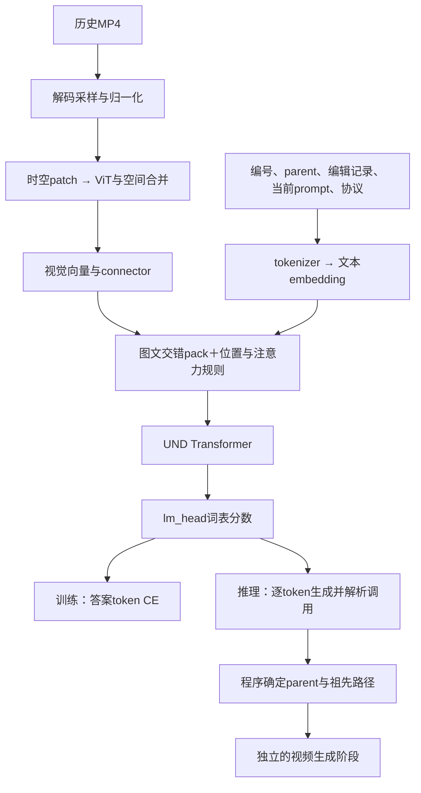

# 历史起点选择：Tool Calling 与现成训练方法调研

日期：2026-10-18，Asia/Singapore。状态：调研与建议，尚未选定训练配方、修改实现或启动实验。Technical owner：[训练接入](../training_integration.md)。既定任务规则见[架构讨论总记录](datamake_architecture_decisions_20261018.md)；本文不替代 ADR-0019。

## 1. 结论与概念澄清

建议第一版采用已有的多模态指令微调方法：**带编号的历史视觉输入 + 单个选择工具 + assistant 答案 token 的交叉熵 SFT**。沿用 Lance 官方理解前向和文本 CE，使用独立理解 adapter 的方案仍待用户确认。生成任务继续用正确父节点单独训练。

“真值是数字”并不意味着不能有效训练。需要区分：

- 把版本 ID 当连续数值做回归，例如用 `(预测编号-正确编号)^2`：不适合任意身份编号，因为编号差不代表语义错误大小。
- 把编号当类别或答案 token：是正常的离散监督，可以训练。
- 把编号放进工具参数：通常仍然是目标 token 的监督；格式更明确，但没有消除选编号的问题，也不能保证比直接输出 ID 更准确。

Tool calling 是“模型表达要调用什么函数、传什么参数，应用程序执行”的接口方式；它本身不指定唯一的训练算法。此处推荐最基础的监督微调，不要求强化学习、长推理链或在线执行视频生成才能计算选择损失。[Transformers 工具调用说明](https://huggingface.co/docs/transformers/en/chat_extras)、[TRL SFT 说明](https://huggingface.co/docs/trl/en/sft_trainer)。

## 2. 最相关的公开资料及借鉴范围

以下为截至本日查阅的原始论文或官方文档，不声称是穷尽检索或当前最佳方法。动态文档的能力不能直接外推到本地软件版本。

| 资料 | 来源支持的事实 | 对本任务的借鉴与限制 |
| --- | --- | --- |
| [TRL SFT](https://huggingface.co/docs/trl/en/sft_trainer) 与[数据格式](https://huggingface.co/docs/trl/en/dataset_formats#tool-calling) | 工具调用数据可提供 `messages`、`tools`、assistant `tool_calls`；SFT 用 token CE，可只监督 assistant/completion | 借鉴格式和监督范围，不代表自定义 Lance 模型能直接交给默认 SFTTrainer |
| [ToolACE，2024/2025修订](https://arxiv.org/abs/2409.00920) | 构造多样化工具调用数据，结合规则和模型验证数据质量，用于函数调用微调 | 借鉴参数校验、样本多样性；不照搬其大型 API 库，也不把它的“无需工具”标签直接替代我们的合法默认调用 |
| [MANTIS，2024](https://arxiv.org/abs/2405.01483) | 多图指令微调学习共指、比较、推理和时间理解 | 历史定位不只是 JSON 格式学习，还要有跨版本指代监督；该论文不是分支视频编辑训练方案 |
| [Qwen2.5-VL，Transformers v4.51.3 文档](https://huggingface.co/docs/transformers/v4.51.3/model_doc/qwen2_5_vl#notes) | `add_vision_id=True` 可为多个视觉输入添加 Picture/Video 编号 | 借鉴 ID 与视觉片段显式配对；我们采用自己的永久节点 ID，不能直接用会随候选排序改变的序号代替 |
| [Pointer Networks，2015](https://papers.neurips.cc/paper/5866-pointer-networks.pdf) | 对输入位置形成概率分布，支持可变长度输出候选空间，最大似然监督正确选择 | 候选打分/指针头是成熟备选；原论文实验不提供我们视频任务的效果证据，接入需要新增头与训练适配 |
| [BFCL V3 官方评测说明，2024](https://gorilla.cs.berkeley.edu/blogs/13_bfcl_v3_multi_turn.html) | 多轮工具使用需要检查状态及调用行为，不只是自然语言回答形式 | 借鉴结构合法与执行正确分开评价；我们仍需自己的起点选择、祖先路径和编辑质量指标 |

## 3. 推荐的第一版输入与答案

### 3.1 输入明确绑定编号、内容和来历

选择器输入包括规则/工具定义、当前最新节点 ID、候选视频的 ID/parent/历史编辑指令、对应视觉内容，以及本轮用户 prompt。示意：

```text
当前最新视频：2
视频0，parent=null：<视频0的视觉内容>
视频1，parent=0，编辑记录“衣服改红”：<视频1的视觉内容>
视频2，parent=1，编辑记录“背景改雪地”：<视频2的视觉内容>
用户：回到衣服已经变红、背景还没有变成雪地的版本，把帽子改白。
```

画面进入 ViT/理解分支；上述尖括号是展示占位，不是实际文本说明替代画面。选择任务不需要目标视频 VAE latent，也不需要先生成一遍视频。动作阶段定位可能需要采样多帧；只给一张关键帧无法保证保留动作信息。历史视觉 token 预算须后续确定。

只显式编号的请求可以依靠文字和元信息解决；涉及真实画面属性的指代才可能需要视觉。记录中的编辑“意图”未必等于实际生成结果，不能一概用旧 prompt 代替视频内容。

### 3.2 单个工具，保留既定 source_video_id 语义

建议工具名 `select_edit_source`，一个必填整数参数 `source_video_id`。示意序列化答案如下，最终训练模板需与推理一致：

```text
<tool_call>
{"name":"select_edit_source","arguments":{"source_video_id":1}}
</tool_call>
```

正常指令“把帽子改白”则输出同一工具，参数为 `-1`。这里的工具只是固定编辑起点，后续生成由应用程序按既定流程触发。无需让模型复述/改写编辑 prompt，避免多引入一个错误来源。

持久化数据可采用标准 assistant `tool_calls` 字段及 `tools` JSON Schema；上述文本是模型最终看到/生成的模板表达，两者不可混为一谈。工具 schema 描述整数类型；执行时另查当前候选集合。将默认行为也表达为一次合法调用，可区分“模型正常选择继续”与“模型漏答后系统回退”。

```text
理解：候选历史 + 本轮prompt → 工具调用
程序：校验 → 将-1解析为本轮最新ID → 固定真实parent
程序：沿parent提取祖先路径
生成：祖先路径 + 选中VAE source + 本轮prompt → 新视频
```

选择器训练只需要正确的调用答案；不需要伪造工具执行结果或把完整视频生成放入每次监督步骤。将来若要训练多步工具对话，才另外定义 tool response。

## 4. 训练方法与样本要求

采用 teacher forcing 的标准 token CE：对目标 assistant 调用的答案和结束边界做监督，不对输入规则、用户 prompt 或历史视觉 token 计算答案损失。模型应学会函数名、字段及正确 ID；第一版不额外设计特殊损失，也不要求生成理由。[TRL SFT](https://huggingface.co/docs/trl/en/sft_trainer)提供这一类标准监督机制。

单个 ID 只包含少量答案 token 并不表示前面的视觉/文本理解学不到梯度；CE 可以经答案 hidden state 反传到参与计算的可训练层。相反，增加大段固定 JSON 或理由不能自动增加有用的选择信号。固定格式容易学会，因此应观察 ID 准确率，不能只看整体 token accuracy 或 loss 下降。

推荐监督覆盖以下情况（仅提出需求，本轮不制作数据）：

| 类型 | 示例 | 监督目标 |
| --- | --- | --- |
| 普通编辑 | “把衣服改蓝” | `-1`，不主动跳历史 |
| 明确编号 | “从视频0开始，把衣服改蓝” | `0` |
| 明确语义回退 | “回到换背景之前的那个版本，再改帽子” | 上下文唯一确定的节点 |
| 易误判的普通指令 | “把红衣服换成蓝色” | 没有明确回退要求时仍为 `-1` |
| 分支干扰 | 另一条分支也有相似衣服 | 结合显式指代与来历确定节点，而非依靠编号邻近 |

必须混合默认和显式样本，分别评价，不能让大量默认样本掩盖总选-1的退化行为。语义不能唯一定位、或者指向不存在节点的请求应先定义标签政策，不能凭推理回退规则自动编成正确-1训练标签。显式指定最新节点应标实际ID还是-1，仍是前轮遗留待确认项。

开发可先检查普通指令/显式编号，再加入显式语义定位；最终需共同验证前两类能力是否保持。候选展示顺序变化时，永久 ID、parent、最新节点元信息须保持一致；不要为了增强而打破“ID按创建时间递增”的已定约定。

训练/验证按整个会话或共同根视频分组，不能把同一树的相邻轮随机分散到两边。另检查较长历史、两位数 ID、相似版本和多条分支。不要把正确父节点或预先筛好的正确祖先路径作为选择器输入泄漏答案；生成器使用 GT 路径则是已确认的独立训练规则。

## 5. 备选方案与最小比较

| 方法 | 需要改变什么 | 建议定位 |
| --- | --- | --- |
| 直接 ID 的 token SFT | 现有理解输入，答案为 `-1` 或具体 ID | 同数据、同上下文、同参数范围的对照；短输出并不天然训练差 |
| 单工具结构化 SFT | 增加 schema/模板及解析校验，仍复用文本 CE | 推荐第一版工程接口；语义准确率提升需实验，不能预先声称 |
| 候选打分/指针选择 | 构建每个节点的表示，加动态候选选择头 | 候选很多或文本选择不稳定时再比较；可加入默认选项，无法代替明确监督 |

指针方案的好处是输出空间可限定在当前候选集合，但依旧会选错合法候选，也要处理默认选项和变化的候选数量。[Pointer Networks](https://papers.neurips.cc/paper/5866-pointer-networks.pdf)支持这种选择建模思路，具体接入是本项目适配建议。

不建议首版同时增加“是否回退”分类头、指针头、理由生成和强化学习；单个工具参数已能表达已定任务。若以后使用受限解码限制为有效 ID，它解决的是非法输出，不保证语义选择正确。

最低评价应分开记录：普通请求误跳率、显式请求选中率、非法格式/非法ID率、回退率、解析后的parent准确率及祖先路径正确率。严格调用正确率与最终选中同一源视频的行为正确率也分开统计，尤其是“显式最新ID”和-1的等价执行情况。错误调用即使通过回退恰好选对，也不能计成模型调用正确。

可增加文字元信息与“元信息+视觉”的对照；若任务只靠明确编号就能完成，视觉无增益并不代表实现失败。需要确实依赖画面且不泄漏答案的样本，才能判断跨版本视觉理解。

## 6. 与本地 Lance 的接入核对

以下是2026-10-18只读代码核对，不是新训练通过证明。路径相对 Lance 实验目录；上游核心与本地适配要区分。

| 机制/边界 | 文件与位置 | 结论 |
| --- | --- | --- |
| 官方理解样本布局 | `lance/data/datasets_factory/dataset_x2t_interleave.py:141` | 可借鉴 user 视觉条件、assistant 文本答案及 `text_template.loss=1` |
| 官方答案标签和 causal shift | `lance/data/dataset_base_train.py:560` | 已将 CE hidden 索引前移一位；接入不能重复 shift |
| 官方语言头 CE | `lance/modeling/lance/lance.py:337` | 已有 `lm_head` 与 token CE，可复用，无需自行发明选择 loss |
| 理解推理入口 | `lance/multiturn/engine.py:266`、`lance/modeling/lance/lance.py:1160` | 有理解自回归文本生成，但无本任务完整工具解析执行器 |
| 当前消息模板 | `lance/data/system_prompt_render.py:20` | 只读取 role/content；直接新增 `tool_calls` 字段不会自动成为模型输入 |
| 基座 tokenizer | `models/Lance/Lance_3B_Video/tokenizer_config.json` | 已有 `<tool_call>`/`</tool_call>` token，但 chat_template 不处理 tools/tool_calls；不能据此宣称已支持该能力 |
| 本地 PEFT 范围 | `lance/train/datamake_branch_lora.py:27`、`lance/train/datamake_peft.py:44` | 当前只有 GEN 或 BOTH，没有 UND-only，需要独立 scope 和隔离验证 |
| UND 梯度开关 | `lance/modeling/lance/qwen2_navit.py:298` | `freeze_und=True` 会 detach UND 激活；训练 UND adapter 不能开启此开关 |
| 纯理解 forward | `lance/modeling/lance/lance.py:283` | 当前视频 trainer 的 visual_gen 会访问 VAE latent；不能只设 mse_weight=0 后直接喂无VAE样本。空 GEN 索引也需正确构造 |

本地 `xks_lance` 检查为 Transformers 4.49.0，未安装 TRL。官方当前 SFTTrainer 的工具/VLM文档可以借鉴，但 Lance 是自定义 `packed_*` 输入、分块注意力和 `ce/mse` 返回接口，不能未经适配直接套默认 Trainer。建议复用已有官方理解 pack/CE 和 PEFT，而不是为一个选择任务整体迁移训练框架。无依赖升级或安装在本轮发生。

参数隔离候选：冻结共同基座、ViT、VAE，训练独立 UND LoRA；生成时加载原生成任务 adapter。原生成 adapter 可能同时含 UND/GEN 权重，因此两者应按任务切换，不能理解为把两个 adapter 同时叠加就完成隔离。冻结 lm_head 仍可把梯度传回 UND，不要求新增类别词表；实现时验证现有工具 token、结束边界和有效词表范围。

## 7. 下一步待讨论

1. 是否采用单工具结构化 SFT 作为接口，保留直接ID对照。
2. 明确最新版本显式编号、歧义/非法引用的监督政策。
3. 确定理解阶段候选视觉预算及独立 adapter 方案，再形成实现和验证计划。

参考图继续等待合适数据。本轮只进行线上资料调研、本地只读代码核对和文档记录；没有创建训练数据、修改训练实现、启动GPU实验或提交作业。

## 8. 四个问题的具体解释（2026-10-18补充）

本节解释候选方案，不新增已接受决定。贯穿例子：V0黑衣普通街道；V1来自V0，改成红衣；V2来自V1，改成雪地；最新为V2。本轮用户说“回到衣服已经变红、背景还是街道的版本，把帽子改白”，正确起点为V1。理解模型实际接收视频内容，画面文字是本文解释。

### 8.1 Tool call由什么组成

可以把它当作“填写操作单”：工具定义说明可以做什么；模型输出工具名和参数；应用程序检查并执行。模型不需要看函数内部Python源码，也不会仅因输出某个函数名就自动执行它。

本任务可定义 `select_edit_source(source_video_id: int)`。其说明包括：普通编辑为-1；显式指向才选对应节点；只能引用本轮存在的节点。模型输出：

```json
{"name":"select_edit_source","arguments":{"source_video_id":1}}
```

程序将其解析成调用请求，检查函数名、参数类型、候选ID后，记录实际parent=1，取路径[V0,V1]，将V1用作生成阶段的VAE source。V2不进入这轮生成历史。新结果编号为V3，保存parent=1；编号仍递增。普通请求输出-1则解析为本轮最新V2，不是报错回退。

工具执行可以返回结构化结果，例如 `{"resolved_parent_id":1,"history_ids":[0,1]}`。但这个结果由程序产生；当前选择任务不需要模型再读回它写一段解释。非法调用按既定推理策略回退并留痕；训练标签不因此改写成-1。[官方工具调用流程](https://huggingface.co/docs/transformers/en/chat_extras)。

### 8.2 两个对照的数据如何构造

两组共享同一事实记录和媒体，只有输出协议、必要系统指令/工具定义不同。示意记录（不是现有已实现schema）：

```json
{
  "session_id": "demo",
  "latest_video_id": 2,
  "history": [
    {"video_id": 0, "parent_id": null, "video_path": "v0.mp4", "edit_prompt": null},
    {"video_id": 1, "parent_id": 0, "video_path": "v1.mp4", "edit_prompt": "衣服改红"},
    {"video_id": 2, "parent_id": 1, "video_path": "v2.mp4", "edit_prompt": "背景改雪地"}
  ],
  "user_prompt": "回到衣服已经变红、背景还是街道的版本，把帽子改白",
  "label_source_video_id": 1
}
```

`label_source_video_id`只用来构造答案，不能连同完整记录直接传给模型。路径用来加载视频，不把文件名当作视觉内容或答案线索。

直接ID方案：

```json
{"role":"assistant","content":"1"}
```

工具方案的数据字段借鉴HF格式：

```json
{
  "role":"assistant",
  "tool_calls":[{
    "type":"function",
    "function":{
      "name":"select_edit_source",
      "arguments":{"source_video_id":1}
    }
  }]
}
```

工具方案另提供 `tools` 定义，模板把它们转换为模型可读的规则和调用文本。直接ID方案的规则要求只输出编号；工具方案要求输出调用。两组不是字节完全相同的prompt，而是相同任务证据、对应各自必要输出协议。[HF工具数据格式](https://huggingface.co/docs/trl/en/dataset_formats#tool-calling)。

普通请求“把帽子改白”对应答案分别是文本 `-1` 与参数 `source_video_id:-1` 的同一工具调用。两组都用答案token CE；同样的根会话划分、采样、初始化与可训练参数范围，记录不同答案长度带来的token量/耗时区别。指标重点是ID和最终parent，不直接比较两组原始loss大小来判断谁更聪明。第一版无需产生对应新视频才能训练选择器。

### 8.3 从视频文件到UND答案的具体流程

以下数值是用于解释的假设采样：每个视频8帧，每帧224×224；不是正式训练采样设置。模型宽度2048、36层以及2×14×14的视觉patch与2×2空间合并，来自当前基座配置/视觉实现。

| 步骤 | 示意形状/数据 | 作用 |
| --- | --- | --- |
| 解码采样、缩放、归一化 | 单视频逻辑形状 `[8,3,224,224]` | MP4变为像素张量；实际内存维序由processor决定 |
| 时空patch整理 | `[1024,1176]` | 8/2×224/14×224/14=1024个小块，每块2×14×14×3=1176个像素数值 |
| ViT编码与内部空间合并 | `[256,2048]` | 每2×2相邻空间patch合为一个输出token；每个视频保留一串特征，并非一个向量 |
| 视觉connector（适用的vit_type路径） | `[256,2048]` | 映射到语言主干的特征空间；输入输出宽度相同也可进行学习到的变换 |
| 三个视频合计 | `[768,2048]` | 分别放到各自编号旁边的视觉位置；视频边界/文字token另计 |
| 文字tokenizer＋embedding | `[N_text,2048]` | 系统规则、编号、parent、编辑记录、当前prompt以及训练期答案前缀进入同宽向量空间 |
| pack序列 | `[L,2048]` | 按图文顺序组织，另带视觉网格、位置、片段长度、样本边界和注意力规则 |
| 36层UND计算 | `[L,2048]` | attention融合当前可见上下文，MLP进一步变换；视觉编码器与UND主干不是同一个模块 |
| lm_head | `[N_answer,V_eff]`（训练） | 答案位置的hidden state映射到有效词表分数，用正确token做CE |

例如文字与视觉按以下逻辑顺序排列：

```text
规则、工具说明、当前最新ID
视频0的编号/来历 → 视频0视觉token
视频1的编号/来历 → 视频1视觉token
视频2的编号/来历 → 视频2视觉token
当前用户指令
assistant答案
```

示意图：



当前官方mask是跨样本隔离、文字因果、视觉块内full attention。答案位于历史之后，可以读取前面的全部候选；预测下一个答案token时不能看到该token或未来答案。文字ID是模型用来绑定内容的标签；RoPE位置/视觉网格描述序列及图像时空位置，两者不是一个概念，编号不会自动编码成树结构。

训练：输入包含正确答案的已知前缀，所有预测位置可以在一次带mask的forward中并行计算。packer已做一次label shift，CE只选答案位置。后一个答案token可见前面的正确答案，这是teacher forcing，不是看见它自己。推理：输入不含正确答案，每次生成下一个token，直到结束，再解析结果。

训练中的损失不落在历史输入token上，不等于历史与训练无关：答案CE仍沿attention路径更新参与理解的UND LoRA。第一版建议冻结ViT与connector，避免同时改变视觉表征；这不影响UND学习如何利用这些特征。选择阶段没有source/target VAE、噪声或flow-matching loss；后面的生成阶段仍使用原有VAE路径。

核验位置：`lance/common/val/utils.py:176`（ViT形状）；`lance/modeling/lance/lance.py:255`（文字embedding/视觉插入）、`:337`（CE）、`:1160`（自回归UND）；`lance/data/data_utils.py:134`（mask）；基座 `llm_config.json`（层数/宽度/vision_config）。

### 8.4 模板和UND-only缺口分别是什么

模板是把磁盘里的字典转换成实际训练文本/token的“排版器”。当前 `lance/data/system_prompt_render.py:20` 只取role与content。下面的记录即使保存正确：

```json
{"role":"assistant","content":"","tool_calls":[{"type":"function","function":{"name":"select_edit_source","arguments":{"source_video_id":1}}}]}
```

若直接交给现有模板，tool_calls不会被渲染，assistant内容为空。下游可能因空目标而丢弃或失败；即使没有报错，也没有正确的调用答案可学。现有tokenizer认识工具边界token不等于数据会自动流入这些token。

适配可采用预处理将标准tool_calls显式序列化到content，或扩展模板读取tools/tool_calls；两条路径都需保证训练/推理一致、结束边界和答案mask正确。这是数据接口工作，不要求重写Transformer。官方x2t数据集还有语言过滤等既有假设，不能不检查就用中文示例直接开始训练。

UND-only则是参数更新范围。当前本地scope只有：

| 范围 | UND LoRA | GEN LoRA及既定生成IO |
| --- | --- | --- |
| generation_experts_and_io | 不训练 | 训练 |
| both_branches | 训练 | 训练 |
| 拟新增UND-only | 训练 | 不训练 |

现有 `freeze.understanding_adapters` 只是切换前两行，不能反向表达第三行；PEFT目标选择始终包含GEN。因此新范围需要正确选择UND的q/k/v/o与MLP模块、校验优化器参数、保存加载合同及无GEN梯度。这不表示Lance没有理解分支，也不表示必须换LoRA算法；仍可复用PEFT。

仅在配置里选BOTH并假设GEN无梯度不是清晰的独立理解合同。当前视频trainer也默认要求VAE输入，需另行支持纯理解数据。另一方面 `freeze_und=True` 会detach理解激活，不能因为冻结基座就误开它；冻结基座参数与保留UND LoRA反向图是两回事。

现有生成adapter即使包含UND参数，也可能仅由视频生成loss训练，并未学过起点选择CE。建议给选择任务单独adapter，按任务切换，避免覆盖旧编辑能力；具体隔离方案仍待确认。

## 9. 上下文、teacher forcing与工具字段的进一步澄清

2026-10-18补充解释，仍属设计讨论。

### 9.1 理解可以看所有已有分支，生成只看选中的祖先路径

第一版在上下文预算允许时，选择器应读取本轮开始前全部可选历史节点：视频内容、永久编号、parent、产生节点的prompt，以及当前prompt。不能先按真值parent筛成一条路径再训练选择器，那会泄漏选择结果。相反，生成任务用真值路径是其独立训练合同。

“全部”不包含本轮尚未生成的目标视频、未来节点、未来prompt或真值选择标签。不是要求所有原始视频都全帧全分辨率输入；采样/缩放与历史预算另定。也不要求把旧工具调用的原始JSON、调试日志都堆入上下文；完整节点/边信息与相关用户指令才是这里的含义。

例如 `V0→V1→V2` 和 `V0→V3→V4` 两条分支，选择器可看V0到V4及对应边指令；选V1后生成只看[V0,V1]与当前prompt。未来历史超过预算时，可能需要检索/分层定位，但本轮不将其记为已定方案。

### 9.2 一次forward并行预测不等于偷看正确答案

设历史和问题合称C，正确答案包含token y1、y2、y3、结束符。训练的预测配对是：

| 用来预测的已知前缀 | 正确下一个token |
| --- | --- |
| C | y1 |
| C,y1 | y2 |
| C,y1,y2 | y3 |
| C,y1,y2,y3 | 结束符 |

标签整体在数据中已知，因此可以把这些位置放在同一序列里，使用一次带因果mask的forward并行计算所有预测。正确label与hidden位置错开一位：预测y2的位置位于y1处，不能读取y2及其后文；y2确实作为输入出现，但只用于后续token预测。当前packer已执行这个shift，不能再移一次。

Teacher forcing意味着前缀使用正确token，而非模型本次猜出的token。若某位置猜错，训练仍计算正确token的CE，不因猜错而改写后续前缀。推理则没有答案：先用C生成hat_y1，再用C,hat_y1生成hat_y2，依次继续。推理会受到自己早先错误的影响，因此自由生成评测不能省略，teacher-forced loss低不保证调用准确。

例如教学用答案 `选择 视频1 结束`（仅为概念token，不是实际tokenizer切分）：训练同时学C→选择、C+选择→视频1、C+选择+视频1→结束。直接ID方案同样训练C→编号及其结束符；具体数字可能占一个或多个token，不应假定整数永远一个token。

### 9.3 tool_calls不是绕开文字生成的神秘通道

对拟采用的Lance自回归方案，模型仍通过lm_head生成token，只是token按工具协议组织。模型输出可示意为 `<tool_call>{"name":"select_edit_source","arguments":{"source_video_id":1}}</tool_call>`。解析器再将其转成assistant.tool_calls结构；dispatcher只调用登记好的选择函数，函数输出不由模型凭空执行。

content和tool_calls首先是消息/API层的字段：content承载普通回答文本（也可含多模态内容）；tool_calls承载明确的工具请求。数据保存为tool_calls时，模板必须先把它序列化进模型输入；模型生成后，解析器再恢复结构。因此API用户可能只看到tool_calls而content为空，但这不表示模型没有生成调用token。

若模型在content里写一段看起来像调用的JSON，而程序只是展示文本，那就没有发生工具执行。只有协议识别、参数校验与执行器衔接之后才有真正的调用行为。可用约束解码辅助格式，但不因此获得自动执行能力或语义正确保证。此解释针对推荐方案及常见自回归工具协议，不主张所有服务内部实现完全相同。

### 9.4 模板缺口应称为文本token路径缺失，不是VAE latent路径缺失

用户对“字段没进入模型”的理解正确。当前模板只读role/content，没有tools/tool_calls渲染逻辑；它们不会仅因出现在JSON里就进入训练序列。

应建立：tools/schema与assistant.tool_calls → 模板序列化 → tokenizer → 文本embedding → 图文packed sequence → UND。工具调用走文字token/embedding通路，不需要新建VAE编码器或把JSON编码成视频latent。输出端还需token解码、协议解析、校验与程序执行；只修改模板并不等于完整工具系统已实现。
