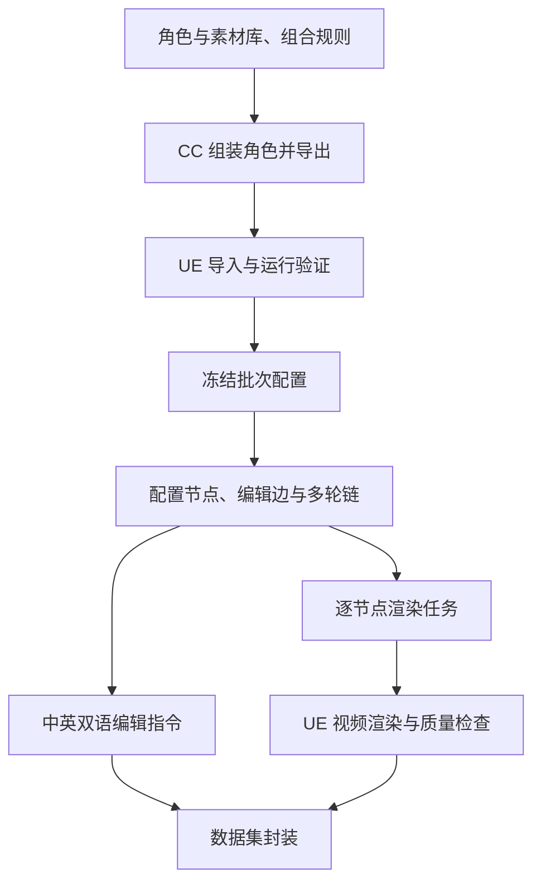

# DataMake 角色工厂：项目技术总览

> 文档 ID：`REPORT-2026-09-28-PROJECT-SUMMARY`
> 文档类型：`history_report`
> 生命周期：`completed`
> 文档用途：从零解释项目的数据模型、资产组织和完整生产流程
> 内容范围：截至 2026-09-28 的技术设计摘要；具体配置与操作以文末链接的专项文档为准
> 最近核验：2026-09-28

## 1. 项目要构建什么

本项目为**多轮视频编辑模型**生产合成训练数据。模型需要根据连续指令修改视频，例如先换服装，再换动作，最后改变拍摄视角，同时保留没有被要求修改的内容。训练数据因此需要明确记录每轮的输入视频、编辑指令和目标视频，以及多轮之间的承接关系。

我们用 Character Creator（CC）构建角色，用 Unreal Engine（UE）控制角色表演和拍摄，再由脚本组织配置、编辑关系、文本与媒体。通过控制生成条件，可以知道两段视频究竟改变了什么，也能为相同状态复用同一段视频。项目的核心交付是数据集与生成流程；模型训练由下游使用这些数据。

## 2. 数据如何表示

整个系统围绕三个对象组织：**节点、原子编辑边和多轮链**。

| 对象 | 含义 | 示例 |
| --- | --- | --- |
| 节点 `Node` | 一套完整配置及其对应的视频；配置包含身份、体型、服装、动作、表情、场景、相机和渲染参数 | 某个角色穿服装 A、执行动作 X，由近景相机拍摄 |
| 原子编辑边 `Edge` | 两个合法节点之间的一次变化，只修改一个允许的编辑因素 | 保持其他配置，服装 A 改成服装 B |
| 多轮链 `Chain` | 按顺序连接的一组节点和边，每一步都以上一步结果为输入 | 换服装 → 换动作 → 换视角 |

节点代表一整段视频，动作时间窗口也属于节点配置。同一个节点可以出现在多条链里，媒体只需生成和保存一份。链通过节点 ID 引用它，不按链重复复制视频。

每轮训练记录可概括为：

```text
输入节点的视频 + 本轮编辑指令 → 输出节点的视频
```

节点之间是否可以连接，由配置和兼容规则决定。文本从已经确定的编辑关系生成，因此指令必须与真实变化一致。

## 3. 系统如何分工



CC 负责角色几何、面部形态、外观和服装装配。外部 Python 编排器通过本地 Bridge 向 CC 插件提交受控任务；插件调用 CC 的 RLPy 接口，并把结果写回任务记录。

UE 接收角色、材质和动画资产，负责运行时装配、动作与表情、场景、相机、时间线和视频渲染。自动化主要通过 UE Python、Sequencer 和 Movie Render Queue 实现。

数据脚本负责资产索引、批次配置、图与链、编辑文本、渲染调度和结果校验。JSON/JSONL 保存机器可读定义，Manifest 记录某一批实际使用的文件、版本和哈希。

## 4. 角色与资产如何组织

### 4.1 体型、身份和外观

角色分成几个可独立描述的部分：

| 部分 | 控制内容 |
| --- | --- |
| `BodyFit` 体型 | 身高、身体比例、体格，以及与服装相关的基础身体形态 |
| `Identity` 身份 | 稳定的面部形状和可辨识特征 |
| `Appearance` 外观 | 皮肤、眼睛、牙齿、眉毛、睫毛、头发和胡须等 |
| `Outfit` 穿搭 | 按合法规则组合出的服装、鞋和局部配件 |
| `Look` 完整外观 | 身份、体型、外观和服装组合后，可供渲染的角色状态 |

体型以保存好的规范 CC 项目为基础，避免依靠少量滑块重建时产生漂移。面部身份使用受控的 Face 配方：从已验证原型出发，只改变允许的局部 Morph，也就是网格形变参数。配方记录随机种子、参数和版本，使身份可以重建。随机变化在准备资产时确定，正式渲染读取冻结配置。

不同部分需要一起验证。比如面部形变不能只检查中性脸，还要检查闭眼、微笑和张嘴时的眼口关系；更换体型后，也需要重新检查服装适配。

### 4.2 服装组合规则

服装按 `Family` 组织。一个 Family 是一组经过定义、允许共同搭配的服装，而不是任意混搭的目录集合。规则描述必选或可选槽位、候选部件、互斥关系，以及必须整体穿戴的锁定套装。

例如，上装可分内搭与外套；下装从裤子或裙子中选择；全身服装与相应上下装互斥。某些套装由多个网格构成，但使用时必须同时加载。鞋可以来自 Family 自带鞋池，也可以通过 ID 引用共享鞋库。除明确批准的情况外，不跨 Family 随意组合单件。

### 4.3 发型与服装兼容

发型选择同时考虑角色适用范围和服装兼容性。性别呈现分类用于选择候选，几何是否适合某个头型仍需要视觉检查；长发、高领、兜帽等组合尤其容易相交。

面向 UE 的统一配置设计把服装规则、发型索引和共享鞋库放在同一个 JSON 中，直接引用 UE 资产。Family 的 `hair_interface` 定义默认 `allow_all` 或 `deny_all`；特殊服装可以覆盖默认规则。组装时，只要选中的资产命中禁用规则，就清除并不加载发型。这里的“全部允许”仍受角色的发型候选范围约束。统一文件是正在整理的设计，不能把样例当作已经接入生产的完整配置。

## 5. 资产怎样从 CC 进入 UE

CC 导出的资产包主要包含 FBX、配套 JSON 和纹理。FBX 携带网格、骨骼、蒙皮等数据；配套 JSON 与纹理支持 UE 材质建立。导入后要确认骨架、材质、形变和动画绑定，而不只是检查文件是否存在。

项目采用过两种角色组织方式：

| 方式 | 工作原理 | 适用目的 |
| --- | --- | --- |
| 完整角色 `FullReference Look` | 在 CC 中组合好身份、服装和外观，作为完整角色导入；编辑时切换对应 Look | 第一批受控数据，减少运行时装配变量 |
| 模块化角色 | 基础身体保留，服装与头发作为独立组件装配 | 复用资产、扩大合法穿搭组合 |

模块化服装使用固定的上装、外套、下装、全身、鞋和附加部件槽位。换装时先核对目标资产，再清空旧槽位并赋入新网格，避免残留上一套服装。服装通过 `Leader Pose` 读取身体的骨骼姿态，跟随同一套身体动画。候选服装数量增加时，不需要为每件衣服永久创建一个角色组件。

骨架兼容是装配前提：常规角色和服装按男女规范骨架组织，不能因为骨骼名称相似就默认可互换。发型还需要正确的材质：本项目这批头发主要以带透明度纹理的发片表现，`Masked` 材质把发片中的空白裁掉，才形成发丝轮廓；使用不透明材质会显示成块状网格。

完整角色导入会带来重复身体和依赖资产，因此模块化资产整理要保留真正需要的网格、材质、纹理和骨架引用，并同步更新索引。文件移动后能加载、外观一致、引用完整，都是迁移验证的一部分。

## 6. 动作、表情与拍摄怎样组合

**身体动作与面部表情分开管理，再按规则合成。** 身体层负责身体、头和颈部运动；面部层控制允许的面部骨骼或形变曲线。动作先区分面部信息是否可替换，锁定的原始表演不能随意覆盖。第一批将批准的身体动作与 Happy 面部片段组合成动画资产，渲染时直接使用对应的 Composite。

每个动作还要规定时间窗口、时长和 Root Motion 策略。Root Motion 指角色根部随动作发生的位移；需要原地表演时使用明确的 InPlace 版本。短动作如何补足时长也由配置决定，保证同一节点不会因播放方式变化而得到不同内容。

**场景、角色站位和相机分别登记。** 场景中有固定角色锚点和允许活动范围，相机记录位置、朝向与构图。Sequencer 把角色、动画、相机和帧范围放在同一时间线上。第一批以每个节点一个相机、5 秒、30 FPS、2560×1440 为具体渲染规格；更换规格需要建立对应的新配置。

场景可以提供多个拍摄点位，但每个点位都要确认主体可见、动作不会越界或被裁切。切换服装或身份时，不应通过临时移动角色来补救构图，否则会引入额外变化。

## 7. 怎样形成多轮编辑数据

首先冻结一个批次允许使用的身份、服装、动作、相机等集合，再依据兼容规则生成节点。第一批按男女两个兼容域分别组合，同域使用兼容的身份、服装和动作，禁止跨域连接。

其节点规模可以直接从配置计算：

```text
2 个兼容域 × 4 个身份 × 4 套服装 × 5 个动作 × 4 个相机 = 640 个节点
```

这说明节点数描述独立的视频状态，不等于编辑指令数或多轮样本数。许多边和链可以复用同一批节点。

下面是一条示意链，假定各项资产均属于同一兼容域，体型、表情、场景和灯光始终固定：

| 状态 | 身份 | 服装 | 动作 | 相机 | 本轮指令 |
| --- | --- | --- | --- | --- | --- |
| N0 | I1 | O1 | A1 | 近景 | 初始视频 |
| N1 | I1 | O2 | A1 | 近景 | 换上服装 O2 对应的穿搭 |
| N2 | I1 | O2 | A2 | 近景 | 改为动作 A2 |
| N3 | I1 | O2 | A2 | 侧面 | 改用侧面视角 |

第一轮得到的服装 O2 会保留到后续两轮。系统检查每条边只有一个编辑轴发生变化，再把链转成逐轮的输入视频、目标视频和中英文指令。表中的 ID 用于解释结构；实际指令使用可理解的服装、动作或身份描述，不暴露内部编号和路径。

链采样包含两种策略：一种不重复编辑轴、不回退，用于清晰的逐步修改；另一种允许重复修改、撤销和回到起点，用于表现更自由的多轮要求。是否重复轴、是否回退、是否回到起点等事实也会记录，便于后续筛选数据。

## 8. 渲染、质量检查与交付

每个节点的完整配置生成稳定 ID。影响画面或时间的参数变化，例如换相机、改动作窗口或分辨率，都应生成新的节点配置；重试次数等运行信息不改变节点身份。固定资产、种子、时序和渲染设置用于支持复现，运行环境也记录在结果中。

渲染调度器读取 `render_jobs.jsonl`，设置 UE 的角色、动画、相机和时间线，再调用 Movie Render Queue。任务有独立的尝试记录、日志和临时输出；验证通过后才登记为可用媒体。恢复运行时会核对配置与文件哈希，复用已有的有效结果，避免重复渲染或错误复用。

质量检查分布在整个流程中：

- 资产阶段检查服装装配、头发穿模、材质、骨架和动作跟随。
- 数据结构阶段检查单因素变化、兼容域、引用完整性、链规则和文本一致性。
- 媒体阶段检查分辨率、帧率、帧数、角色是否运动，以及构图、穿模和面部表现等视觉问题。

每段视频附带 `sidecar.json`，记录实际角色与动画绑定、配置、渲染参数、版本、哈希和检查结果。Ground Truth（真值）来自确定性配置和 UE 的实际绑定，便于判断模型应当改变和保留什么。

最终数据集包含以下内容：

| 内容 | 用途 |
| --- | --- |
| `graph/` | 节点、编辑边、多轮链及其关系 |
| `text/` | 每轮中英文指令和完整对话记录 |
| `media/nodes/` | 按节点保存的唯一视频 |
| `metadata/` | 配置、实际绑定和其他追溯信息 |
| `manifest/`、`qa/`、`checksums/` | 文件清单、质量报告与完整性校验 |

交付时，每轮文本中的输入和输出引用都必须能找到有效视频。修改资产、图、文本或媒体后采用新版本，保留配置到最终文件之间的对应关系。

## 9. 扩展项目时遵循什么规则

扩充多样性的过程是：增加候选资产或拍摄配置，完成必要的适配检查，登记可用范围，再生成新的节点和编辑链。增加了一个外观选项，不代表它自动成为新的编辑轴；只有明确了编辑语义和验证规则，才能把它用于某轮指令。

模块化换装、更多发型、动作和场景都沿用这套数据结构。更复杂的体型、年龄、道具或表情需要额外处理适配和控制问题，不能从某个平均体型或代表动作的验证直接推导为全面可用。样例配置、技术试验与正式批次各自有明确范围，生产使用的集合以冻结清单为准。

## 10. 进一步阅读

本文汇总概念和模块关系；复现具体操作时，从对应专项文档进入：

| 内容 | 文档 |
| --- | --- |
| 项目完整流程和文档导航 | [项目主文档](../../../README.md) |
| 体型、身份与外观 | [体型与身份](../../../technical/character_creator/BODYFIT_IDENTITY_AGE.md)、[外观资产](../../../technical/character_creator/APPEARANCE_ASSETS.md) |
| 服装规则与 UE 换装 | [服装系统](../../../technical/character_creator/OUTFIT_SYSTEM.md)、[UE 角色运行时](../../../technical/unreal/CHARACTER_RUNTIME.md) |
| CC 到 UE | [资产传输索引](../../../technical/transfer/README.md) |
| 动作、表情和拍摄 | [动作与表情](../../../technical/unreal/ANIMATION_EXPRESSION_MORPH.md)、[场景与相机](../../../technical/unreal/SCENE_CAMERA_SEQUENCE.md) |
| 图、链与指令 | [配置图与编辑链](../../../technical/dataset/CONFIG_GRAPH_AND_CHAINS.md)、[Prompt 层](../../../technical/dataset/PROMPT_LAYER.md) |
| 渲染和交付 | [渲染执行](../../../technical/rendering_release/RENDER_EXECUTION.md)、[数据集封装](../../../technical/rendering_release/DATASET_PACKAGE.md) |
